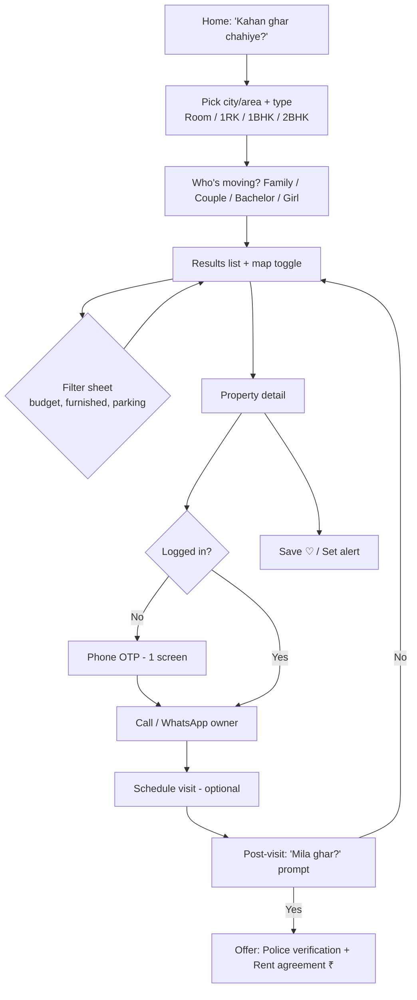
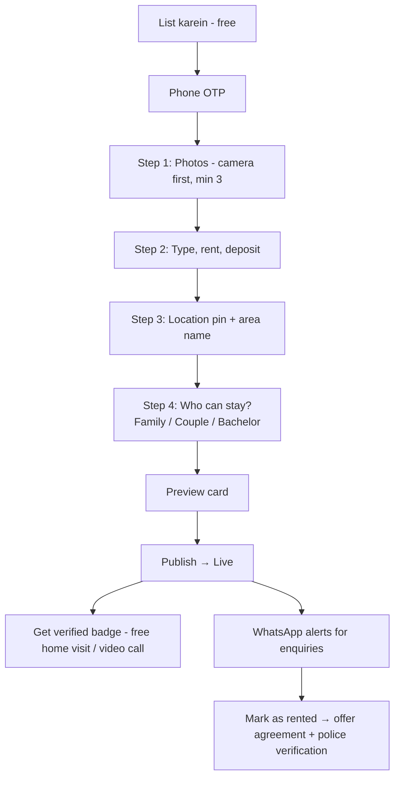

# MASTER DESIGN SYSTEM — Ghar Foundation (v2)

> Source of truth. Page-specific overrides go in `design-system/pages/<page>.md`. User journeys live in `design-system/USER-FLOWS.md`.
> Synthesised from local skills: `ui-ux-pro-max`, `design-taste-frontend`, `high-end-visual-design`,
> `minimalist-ui`, `redesign-existing-projects`, `stitch-design-taste`, `imagegen-frontend-web`, `imagegen-frontend-mobile`.
> Rejected for this product: `industrial-brutalist-ui` (too cold for owners 40–65), `design-taste-frontend-v1` (superseded).

---

## 0. Design Read

**Reading this as:** a trust-first local rental marketplace ("kiraye ka makaan") for families & couples in
Uttarakhand Tier-2/3 towns, used mostly on budget Android phones over 4G, with a **warm, homely, honest**
language — closer to a well-run neighbourhood notice board than a VC-funded SaaS.

**Audience:** Tenants 22–45 (families, working couples, transferees). Owners 40–65 (uncles/aunties, not tech-savvy).
**Not:** OYO / Airbnb (no nightly stays, no hotel vibe), not NoBroker clone (no blue corporate SaaS).

### Dials (from `design-taste-frontend`)
| Dial | Value | Why |
|---|---|---|
| DESIGN_VARIANCE | **4** | Trust-first, older owners. Predictable layouts. |
| MOTION_INTENSITY | **3** | Low-end phones. Subtle only. |
| VISUAL_DENSITY | **5** | Listing cards need rent, area, type, verified at a glance. |

### Skill audit (`.agent/skills` + `.agents/skills`)
| Skill | Folder | Used for | Decision |
|---|---|---|---|
| `ui-ux-pro-max` (data: products/landing/ui-reasoning CSV) | `.agent` | Product #38 Real Estate, #50 P2P Marketplace; Landing #22 Marketplace/Directory | **Adopted:** search-first hero, categories, featured listings, trust/safety, "List your item" in navbar, map integration (must-have), popular-search suggestions, map hover pins. **Overridden:** "Trust Blue + Gold + Glassmorphism" → too corporate/luxury for Tier-2 rentals; we use Mitti & Pahad. Flagged anti-pattern kept: *poor photos* |
| `design-taste-frontend` | `.agents` | Dials, anti-slop rules | Adopted |
| `high-end-visual-design` | `.agents` | Warm diffused shadows, spacing rhythm | Adopted (toned down) |
| `minimalist-ui` | `.agents` | Warm monochrome base, flat bento | Adopted |
| `redesign-existing-projects` | `.agents` | Audit of current emerald UI | Adopted |
| `stitch-design-taste` (+ DESIGN.md) | `.agents` | Semantic token format | Adopted |
| `imagegen-frontend-web` / `-mobile` | `.agents` | Per-section composition variety, phone mockups | Adopted for comps |
| `image-to-code` | `.agents` | Comp → code pipeline | For build phase |
| `industrial-brutalist-ui` | `.agents` | — | Rejected (cold) |
| `design-taste-frontend-v1` | `.agents` | — | Superseded by v2 |

---

## 1. Brand Personality
| Is | Is not |
|---|---|
| Warm, local, honest | Corporate, cold |
| Transparent (real photos, real rent) | Hype, fake urgency |
| Clear, simple English | Jargon ("leads CRM", "deal pipelines") in consumer UI |
| Calm, trustworthy | Flashy gradients, neon glow, excessive glass |

Voice examples:
- CTA: **"Call Owner"**, **"WhatsApp Inquiries"**, **"List Your Property — Free"**
- Empty state: "No rooms available in this locality right now. Set an alert and we will notify you as soon as a verified room opens up."

---

## 2. Typography

| Role | Font | Weights | Notes |
|---|---|---|---|
| Display / headings | **Bricolage Grotesque** | 600, 700 | Characterful, warm, not "AI default" |
| Body / UI | **Plus Jakarta Sans** | 400, 500, 600 | Very legible on small screens |
| Hindi (Devanagari) | **Mukta** | 400, 600 | Matches Jakarta's x-height; used for `lang="hi"` |
| Numbers (rent) | Plus Jakarta Sans + `tabular-nums` | 700 | Rent must align in lists |

Banned (per skills): Inter, Roboto, Arial, Open Sans as primary. Outfit is retired.

Load via `next/font/google` only (never `<link>`), `display: "swap"`, subset `latin` + `devanagari`.

### Type scale (mobile → desktop)
| Token | Mobile | Desktop | Line height | Use |
|---|---|---|---|---|
| `display` | 32px | 56px | 1.05, tracking -0.02em | Home hero only |
| `h1` | 26px | 40px | 1.15 | Page titles |
| `h2` | 21px | 28px | 1.25 | Section titles |
| `h3` | 18px | 20px | 1.3 | Card titles |
| `body` | 16px | 16px | 1.6 | Default (never below 16px on inputs — iOS zoom) |
| `small` | 14px | 14px | 1.5 | Meta (area, posted date) |
| `micro` | 12px | 12px | 1.4, tracking 0.04em | Badges, eyebrow |
| `rent` | 22px/700 | 24px/700 | 1 | Price on cards |

Max line length: 65ch. Body text colour never pure black.

---

## 3. Colour — "Mitti & Pahad" (earth & hills)

Replaces generic emerald/slate SaaS palette.

| Token | Hex | Use |
|---|---|---|
| `--bg` | `#FBF7F1` | App background (warm cream) |
| `--surface` | `#FFFFFF` | Cards, sheets |
| `--surface-2` | `#F3ECE2` | Section bands, input fill |
| `--ink` | `#1F1A17` | Headings |
| `--ink-2` | `#57504A` | Body |
| `--ink-3` | `#8A8178` | Meta / placeholders (AA on white at 14px+ bold only) |
| `--line` | `#E7DED2` | Hairlines (use sparingly) |
| `--primary` | `#C2522D` | **Terracotta** — primary CTA, links, active tab |
| `--primary-hover` | `#A8431F` | |
| `--primary-soft` | `#FBE9E1` | Selected chips, soft backgrounds |
| `--forest` | `#1F5D4A` | **Pahadi green** — Verified, trust, success |
| `--forest-soft` | `#E3F0EA` | Verified badge bg |
| `--haldi` | `#E0A526` | Featured / "Naya" highlight (never body text) |
| `--danger` | `#B42318` | Errors, report |
| `--whatsapp` | `#1DA851` | WhatsApp button only |

Dark mode: **deferred** (target users rarely use it; halves QA effort). If added: bg `#16120F`, surface `#211B17`.

Rules:
- One terracotta CTA per screen region. Secondary actions = outline or ghost.
- Green means **verified/true** only. Never decorative.
- Contrast ≥ 4.5:1 for all text (WCAG AA).

---

## 4. Spacing, Radius, Elevation, Z-index

**Spacing (4px base):** 4, 8, 12, 16, 20, 24, 32, 48, 64, 96.
Screen padding: 16px mobile, 24px tablet, 32px desktop. Max content width 1200px.
Section spacing: 48px mobile / 96px desktop (marketing pages); 24px inside app.

**Radius:** `sm 8px` (chips, inputs) · `md 12px` (buttons) · `lg 16px` (cards) · `xl 24px` (sheets, hero image) · `full` (avatars, pills).

**Elevation (warm-tinted, diffused — no harsh grey shadows):**
- `e1`: `0 1px 2px rgba(60,40,20,.06)` — cards at rest
- `e2`: `0 8px 24px -8px rgba(60,40,20,.14)` — hover / sticky bars
- `e3`: `0 24px 48px -12px rgba(60,40,20,.22)` — modals, bottom sheets

**Z-index scale:** base 0 · sticky 10 · bottom-nav 20 · dropdown 30 · sheet/modal 40 · toast 50. No arbitrary values.

---

## 5. Iconography & Imagery
- **Icons:** `@phosphor-icons/react`, weight `regular` (UI) / `fill` (active tab). Size 20/24. One family only — migrate off Lucide/Material.
- **No emoji** in UI.
- **Photos:** real owner photos, 4:3 ratio in cards, 16:9 in gallery. Show photo count chip. Cloudinary `f_auto,q_auto,w_600`.
- No stock "happy family" images on listings. Marketing pages may use real Dehradun/Haldwani street photos.
- Empty states: simple line illustration + one clear action.

---

## 6. Components

### Buttons
| Variant | Style |
|---|---|
| Primary | bg `--primary`, white text, radius md, height 48 (mobile) / 44 (desktop), weight 600 |
| Secondary | 1.5px border `--ink`, transparent bg |
| Ghost | text `--primary`, no border |
| WhatsApp | bg `--whatsapp`, WhatsApp glyph, "WhatsApp karein" |
| Call | bg `--forest`, phone glyph, "Call karein" |

States: hover darken, `active:scale-[0.98]`, focus ring `2px --primary` offset 2, disabled 40% opacity, loading = spinner + label kept.
Touch target ≥ 44×44. Motion: `150ms cubic-bezier(0.32,0.72,0,1)`.

### Listing Card (core component)
```
┌───────────────────────────┐
│ [photo 4:3]   ♡   📷 8    │  ← favourite + photo count
│ ✓ Verified  · Family-friendly │  ← badges (forest / neutral)
├───────────────────────────┤
│ ₹8,500 /month              │  ← rent (tabular, 700)
│ 1BHK · Semi-furnished      │
│ Prem Nagar, Dehradun · 2 km│
│ Deposit ₹10k · Available now│
│ [Call]  [WhatsApp]         │  ← only on detail page / expanded
└───────────────────────────┘
```
No borders — surface on cream bg + `e1`. Whole card tappable.

### Badges / Chips
- Verified (forest-soft bg, forest text, seal-check icon)
- Family OK · Couples OK · Bachelors OK · Girls only (neutral `--surface-2`)
- Owner direct vs. Broker (always disclosed — trust rule)
- Filter chips: pill, `--surface-2`; selected = `--primary-soft` + primary text.

### Inputs
Height 48, radius sm, fill `--surface-2`, no border at rest, 1.5px `--primary` border on focus. Label above (never placeholder-only). Errors below in `--danger` with icon. Phone input with fixed `+91`.

### Navigation
- **Mobile:** bottom tab bar (5 max): Ghar dhoondein · Saved · List karein (centre, primary) · Messages · Profile.
- **Desktop:** top bar, logo left, search centre (on results), "List your property" CTA right.
- Sticky search header on results; filter opens as **bottom sheet**.

### Feedback
Toasts bottom-centre (above tab bar), 4s. Skeleton loaders shaped like cards (no spinners for lists). Optimistic favourite toggle.

---

## 7. Motion
- Durations: 150ms (micro), 250ms (sheets), 400ms (page/hero reveal).
- Easing: `cubic-bezier(0.32,0.72,0,1)`. No linear / default ease.
- Only `transform` & `opacity`. No scroll-jacking, no infinite loops.
- Respect `prefers-reduced-motion`.
- `backdrop-blur` only on sticky header / bottom sheet scrim.

---

## 8. Core User Flows

### 8.1 Tenant — find a room (primary flow, target ≤ 60s to first call)

Rules: browsing is **login-free**. Login is asked only at contact. Never more than 1 auth screen.

### 8.2 Owner — list a property (target ≤ 3 min)

Alternate path: **"WhatsApp pe bhej do"** — owner sends photos + rent to WhatsApp number, team lists it.
Progress bar with 4 steps, autosave drafts, back never loses data.

### 8.3 Monetisation touchpoints (non-intrusive)
| Moment | Offer |
|---|---|
| Tenant marks "Mila ghar" | Rent agreement + police verification bundle |
| Owner marks "Rented" | Same bundle, owner side |
| Listing 7 days with low views | "Boost ₹99 / 7 days" |
| Before move | Tempo/shifting partner |

---

## 9. Information Architecture

**Public:** Home · Search results · Property detail · List your property · Pricing/Services · Safety tips · About · FAQ · Contact · Terms/Privacy
**Tenant app:** Saved · Alerts · Messages · Visits · Profile
**Owner app:** My listings · Enquiries · Visits · Services (agreement/verification) · Profile
**Remove from user-facing UI for MVP:** Analytics, Leads CRM, Documents vault, Agency plans.

---

## 10. Page Blueprints

**Home:** cream bg · left-aligned hero "Apna kiraye ka ghar, seedha owner se." · large search box (area + type + who) · popular areas chips (Prem Nagar, Rajpur Rd, Haldwani, Rudrapur…) · "Naye rooms" horizontal scroll · 3-step "Kaise kaam karta hai" (asymmetric, not 3 equal cards) · trust strip (verified owners count, no brokerage) · owner CTA band in terracotta.

**Results:** sticky search pill · chips row · list (1 col mobile, 2–3 desktop) with map toggle · result count + sort.

**Detail:** gallery (swipe) · rent + deposit block · badges · key facts grid (type, furnishing, floor, water/electricity, parking) · "Who can stay" · location map (approx until contact) · owner card (name, member since, verified) · **sticky bottom bar: Call + WhatsApp** · report listing link · safety tips.

---

## 11. Accessibility & Performance
- AA contrast, visible focus, labels on all inputs, `alt` on all photos, `lang="hi"` on Hindi strings.
- LCP < 2.5s on 4G mid-tier Android. JS per route < 170KB. Images lazy below fold.
- Works offline-lite (PWA cached shell + saved listings).

---

## 12. Anti-patterns (Banned)
- AI-purple / emerald SaaS gradients, glassmorphism everywhere, mesh blobs.
- Three equal feature cards. Centered-everything hero.
- Placeholder-only inputs. Forced login before browsing.
- Hiding broker status. Fake "5 people viewing" urgency.
- Pure `#000` text/bg. Arbitrary z-index. Mixed icon families. Emoji icons.
- Monthly subscription walls for individual owners.

---

## 13. Implementation Map
| Item | Action |
|---|---|
| `src/app/theme.css` | Replace emerald/blue/tertiary palettes with tokens in §3 |
| `src/app/layout.tsx` | `next/font`: Bricolage Grotesque, Plus Jakarta Sans, Mukta |
| Tailwind config | Map tokens → `bg-bg`, `text-ink`, `bg-primary`, radii, shadows `e1–e3` |
| Icons | Replace Lucide/MUI icons with Phosphor |
| `ListingCard` | Rebuild per §6 |
| Bottom nav | New mobile component per §6 |
| Pricing page | Replace subscriptions with free listing + paid services |
