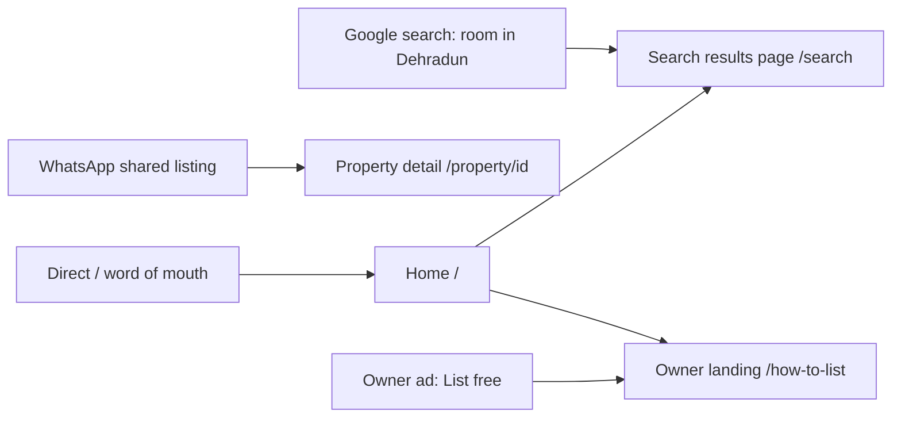
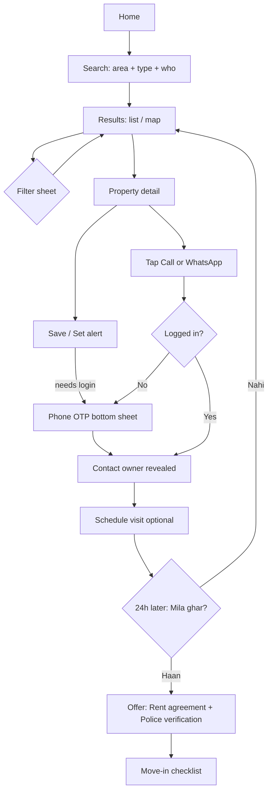
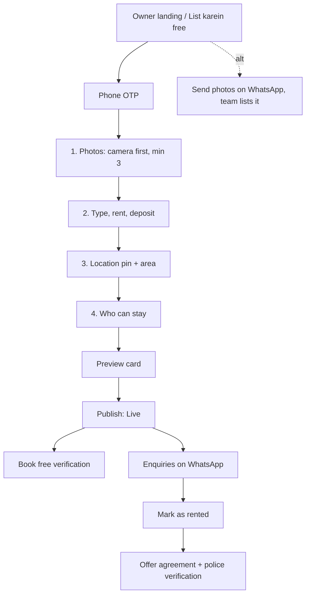
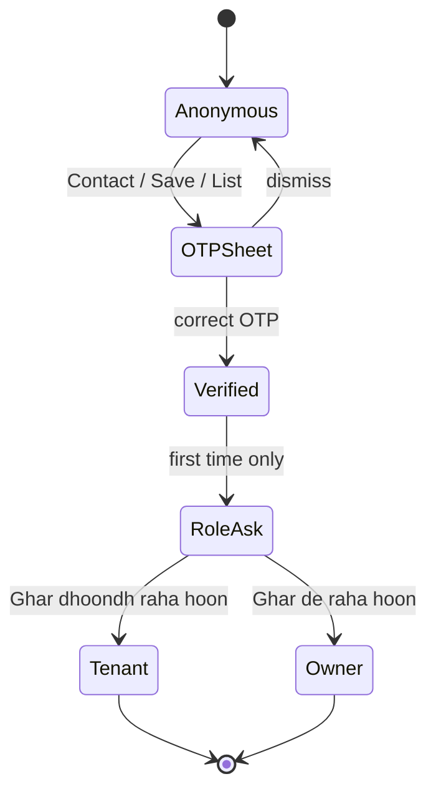

# User Flows — How Users Interact with Ghar Foundation

> Companion to `MASTER.md`. Every screen below uses MASTER tokens/components. Rules: browsing is login-free,
> one auth screen max (phone OTP), one terracotta CTA per region, Hinglish copy.

## 0. Personas
| Persona | Goal | Device | Biggest fear |
|---|---|---|---|
| **Tenant – Rohit (28, transferee)** | Find 1BHK in 1 week, no broker | Android, 4G | Fake listings, broker fees |
| **Tenant – Family (Meena, 38)** | Safe 2BHK near school | Shared phone | Safety, hidden charges |
| **Owner – Sharma ji (58)** | Rent out floor quickly to a decent family | Android, WhatsApp-heavy | Tech complexity, bad tenants |

## 1. Entry Points

## 2. Tenant — Discover to Move-in

**Interaction details**
| Step | Interaction | Feedback |
|---|---|---|
| Search | Area autocomplete (Hindi + English), chips for type/who | Instant result count "124 ghar mile" |
| Results | Infinite scroll, 20/page; map toggle FAB | Skeleton cards, no spinners |
| Save ♡ | Tap → heart fills, haptic | Toast "Saved. Login karke sync karein" |
| Contact | Sticky bottom bar Call + WhatsApp | OTP sheet slides up (e3), keeps context — never navigates away |
| OTP | 6 boxes, auto-read SMS, resend 30s | Error inline in `--danger` |
| Report | "Galat listing?" link → 3 reason chips | "Shukriya, 24 ghante mein check karenge" |

## 3. Owner — List in ≤ 3 minutes

- Progress bar (4 steps), autosave every field, back never loses data.
- Large inputs (48px), numeric keyboard for rent, ₹ prefix, deposit suggestion "2 mahine ka = ₹17,000".
- Day 7 low views → nudge "Boost ₹99 / 7 din" (dismissible, never blocking).

## 4. Auth Flow (single pattern everywhere)

`/login` and `/signup` collapse into one `AuthScreen` (phone first; Google as secondary). Return user to the exact action they started.

## 5. Logged-in Navigation (mobile bottom nav)
| Tenant | Owner |
|---|---|
| Search · Saved · Messages · Visits · Profile | My listings · Enquiries · Visits · Services · Profile |
Role switch lives in Profile. Analytics / Leads / Documents hidden for MVP (per MASTER §9).

## 6. Edge & Empty States
| State | Copy | Action |
|---|---|---|
| No results | "Is area mein abhi koi room nahi." | Set WhatsApp alert |
| Offline | "Internet nahi hai — saved ghar dekh sakte hain" | Open Saved |
| Listing rented | "Ye ghar mil gaya kisi ko" | Similar homes row |
| OTP fails 3× | "WhatsApp pe OTP bhejein?" | WhatsApp OTP |
| Owner no enquiries 3 days | "Photos better karein — 2x zyada calls" | Edit photos |

## 7. Route Map
| Route | Flow role |
|---|---|
| `/` | Tenant landing (§ LANDING-PAGES 1) |
| `/search` | Results |
| `/property/[id]` | Detail + contact |
| `/how-to-list` | Owner landing (§ LANDING-PAGES 2) |
| `/post-property` | Owner 4-step wizard |
| `/pricing` | Services landing (§ LANDING-PAGES 3) |
| `/login`, `/signup` | Same AuthScreen |
| `/onboarding` | Role ask (one screen) |
| `/(user-app)/*` | Logged-in app |

