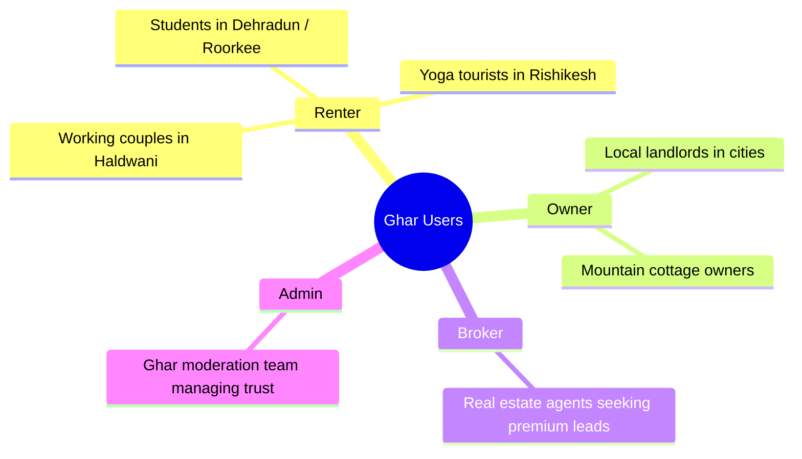

# Product Requirements Document (PRD) — Ghar Foundation

Ghar Foundation is a production-ready, mobile-first rental property platform dedicated exclusively to **Uttarakhand, India (Devbhoomi)**. It bridges the gap between renters (students, tourists, local workers) and property owners/brokers, delivering a clean, fast, and lightweight SaaS experience optimized for mountain connectivity.

---

## 1. Executive Summary & Goals

### 1.1 Problem Statement
Uttarakhand's rental market is highly fragmented. Generic portals like MagicBricks or 99acres are cluttered with outdated listings, irrelevant metropolitan filters, high fee paywalls, and heavy resource loads that fail on slow 3G/4G mountain networks. Renters are frequently scammed by duplicate listings or forced to pay exorbitant commissions to middle-tier brokers.

### 1.2 Solution
Ghar Foundation provides:
- A dedicated directory covering all **13 districts** of Uttarakhand.
- Verification checks by administrators to ensure listings correspond to real local spaces.
- A **mobile-first PWA architecture** designed to operate smoothly under low bandwidth.
- A direct, free-of-charge connection channel (WhatsApp/Call/Chat) for verified users.
- Subscriptions and featured listing upgrades for commercial brokers and landlords.

### 1.3 Key Metrics (KPIs)
- **Performance**: Page Load time < 1.5s on 3G connections.
- **Verification Rate**: > 80% of listed properties verified by admin review.
- **User Engagement**: > 40% renter-to-owner WhatsApp redirection success rate.
- **Quality Control**: Suspicious listings flagged and moderated within 4 hours.

---

## 2. User Personas & Scenarios

### 2.1 The Renter
*   **Persona**: Aman, a university student moving to Dehradun.
*   **Scenario**: Needs a budget-friendly 1 RK/PG near his college. He has limited internet data and wants to filter by "Bachelor Friendly" and "Pet Friendly" before contacting the owner directly over WhatsApp.

### 2.2 The Landlord
*   **Persona**: Devendra, a retired officer in Mussoorie.
*   **Scenario**: Owns a cozy wooden cottage in Landour. Wants to post his listing easily on a mobile device, choose "Family Preferred", upload 3 pictures, and receive phone inquiries directly without paying middleman brokerage.

### 2.3 The Professional Broker
*   **Persona**: Satish, owner of Garhwal Properties in Rishikesh.
*   **Scenario**: Manages 15+ rental studios and retail shops. Wants to purchase a monthly "Premium Plan" to feature his properties at the top of search rankings and display a "Verified Broker" badge on his cards.

### 2.4 The Administrator
*   **Persona**: Admin team.
*   **Scenario**: Audits user flags. Checks listings marked as "Fake", reviews landlord credentials, and updates verified badges.

---

## 3. Product Features & Functional Requirements

| Feature ID | Category | Feature Name | Description | Priority |
| :--- | :--- | :--- | :--- | :--- |
| **FR-01** | Auth | Multi-Channel Login | Support Clerk Google/Apple SSO, Phone OTP login, and Guest mode. | **P0 (Critical)** |
| **FR-02** | Search | Multi-Tab Search | Custom search bar with category filters (Rentals, PGs, Commercial). | **P0 (Critical)** |
| **FR-03** | Search | Interactive Filters | Quick tags (bachelor, pet, parking) and range selectors for rent. | **P0 (Critical)** |
| **FR-04** | Discovery | Property Map View | Integrated Map displaying property coordinates and nearby landmarks. | **P1 (High)** |
| **FR-05** | Listing | Multi-Step Wizard | Landlord posting wizard (Details, Location, Uploads, Preview). | **P0 (Critical)** |
| **FR-06** | Listing | Photo Gallery | Swipeable image carousel with loading state indicators. | **P0 (Critical)** |
| **FR-07** | Moderation | Abuse Reporting | Renter tool to report listings as fake, misleading, or offline. | **P0 (Critical)** |
| **FR-08** | Moderation | Admin Audit Panel | Admin board to delete flagged items or verify submitted properties. | **P1 (High)** |
| **FR-09** | Monetization | Subscription Manager| Payment tier selection (Basic Free vs Pro Featured listings). | **P1 (High)** |
| **FR-10** | Offline | PWA Offline Support | Local storage caching of properties and details for remote areas. | **P2 (Medium)** |

---

## 4. Non-Functional Requirements (NFRs)

### 4.1 Performance & Latency
- The bundle must compile with Next.js static asset optimization.
- Image assets must be optimized dynamically using CDN (Cloudinary / Unsplash resize queries).
- CSS files must prioritize Tailwind variables for dynamic render cycles without render-blocking scripts.

### 4.2 Security & Data Privacy
- SSO redirects must restrict destination URLs to verified domains to protect against Open Redirect vulnerabilities.
- User metadata (roles and onboarding configurations) must be stored in Clerk `publicMetadata` and verified on the server-side middleware.
- Database access keys must never be exposed client-side.

### 4.3 PWA & Responsiveness
- Layouts must be built mobile-first, ensuring high-density layouts resize beautifully down to 320px screens.
- Touch targets for buttons and filters must be at least 44x44px.

---

## 5. Monetization Strategy

Ghar Foundation implements a dual-value monetization strategy:
1.  **Featured Listings (Promoted)**: Landlords pay a small fee to pin their property to the top of search queries and the homepage grid for 7/14/30 days.
2.  **Broker Subscriptions**: Real estate agents pay a monthly flat fee to host unlimited listings, receive a "Verified Agency" badge, and get priority email alerts on prospective tenant inquiries.
3.  **Local Banner Sponsorships**: Space reserved at the bottom of pages for Uttarakhand-based hospitality businesses, homestays, and tour operators (such as wellness retreats in Tapovan).

---

> [!NOTE]
> This PRD serves as the source of truth for the product team. Any deviations or modifications to features must be signed off during regular sprint planning audits.
