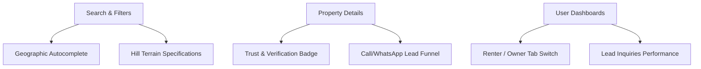
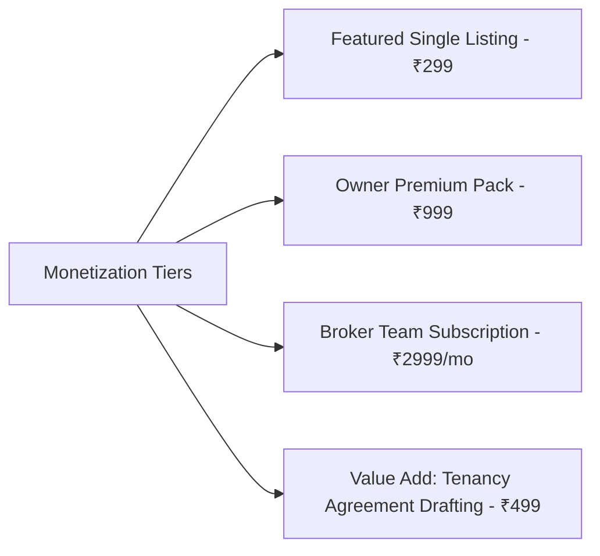

# Ghar Foundation — Product & Architectural Evolution Report (v1.0 to v2.0)

This report evaluates the **Ghar Foundation** platform architecture, user experience, database schema, and monetization strategies, presenting structured recommendations to elevate the product from version 1.0 to a premium, production-grade 2.0 marketplace.

---

## 1. Product Review
### 1.1 Core Positioning & Vision
*   **Current State**: Focused on offering direct-contact listing directories in Uttarakhand, bypassing heavy broker fees.
*   **Problem**: Risks being perceived as a generic directory. In hilly terrains, remote landlords face difficulties managing digital listings, while tenants face high friction verifying if a property has running water or standard cellular reception (e.g., Jio vs. Airtel vs. BSNL).
*   **Suggested Improvement**: Re-position as **Devbhoomi's Trust-Verified Rental Marketplace**. Address local geological bottlenecks like water supply reliability (e.g., Spring water vs. Municipality hours), cellular signal strength, and accessibility index (e.g., walking distance from the main road/stairs climbs).
*   **Business Impact**: Higher brand recall, organic regional word-of-mouth adoption, and increased conversion rates for paid listings.
*   **User Impact**: Tenants avoid renting properties with poor connectivity or difficult access; landlords attract high-quality long-term tenants.
*   **Technical Impact**: Add descriptive fields for cellular networks and road distance to the `Property` model.
*   **Development Complexity**: Low
*   **Priority**: P0
*   **Expected ROI**: High (differentiates the brand immediately).

### 1.2 MVP Scope & Roadmap
*   **Roadmap Evolution (v1.0 to v2.0)**:
    1.  *Phase 1 (Active)*: Basic functional listings directory for Uttarakhand.
    2.  *Phase 2 (Growth)*: Implementation of local trust matrices, programmatic SEO, and automated verification queues.
    3.  *Phase 3 (Monetization)*: Featured listing upgrades, Pro Broker team panels, and verified tenancy templates.

---

## 2. User Flow Review
Across the user lifecycle, several state boundaries need explicit handling to prevent high drop-offs:

### 2.1 Student / Roommate PG Splitting Flow
*   **Problem**: In university hubs (e.g., UPES Dehradun, IIT Roorkee), students rent flats collectively. Standard flows only track a single tenant.
*   **Suggested Flow**: Provide a "Split Lease / Roommate Finder" tag. When selected, the listing allows renters to search for active room shares and request partial rentals.
*   **Priority**: P1 | **Complexity**: Medium | **ROI**: High (captures student market share).

### 2.2 Landlord Image Dropzone & Optimizations
*   **Problem**: Landlords uploading properties in areas with flaky mobile connections face form timeout issues on large images.
*   **Suggested Flow**: Integrate progressive client-side canvas compression in the file-dropzone before triggering server upload actions. Show step-by-step upload progress bars.
*   **Priority**: P0 | **Complexity**: Low | **ROI**: High (saves server bandwidth and decreases drop-offs).

### 2.3 System State Boundaries (Missing UX)
*   **Loading States**: Skeleton placeholders for cards in search grids during query updates.
*   **Empty States**: Clear "No properties found in this area, try widening your search radius" illustrations with direct buttons to "Save Search and Alert Me".
*   **Error States**: React Error Boundaries wrapper on maps to gracefully degrade if the Google Maps/Mapbox API key quota is exhausted.

---

## 3. Feature Review



### 3.1 Terrain-Specific Listing Indicators
*   **Water Reliability Tag**: Mountain water supplies fluctuate. Options: "24/7 Gravity Source", "Municipal Supply (Fixed Hours)", "Water Tanker Dependent".
*   **Elevation Accessibility Index**: Tracks how many stairs/slopes are required to reach the property entrance from the motorable road (e.g., "0 stairs - Roadside", "10-50 stairs climb", "Steep walking track").
*   **Power Backup Options**: "Inverter Pre-installed", "Generator Friendly", "No Backup".

### 3.2 Automated Lead Routing
*   **WhatsApp Dynamic Lead Tracker**: Directs tenants to WhatsApp using pre-filled localized text: *"Hi [Owner], I am interested in your [2 BHK Flat] in [Rajpur Road, Dehradun] listed on Ghar Foundation. Is it available?"*.

---

## 4. Database Review (Prisma Schema Evolution)
To support v2.0 features, the following database extensions are proposed:

### 4.1 Index Optimizations
To support rapid search queries across pricing, location, and property categories, add index declarations to `schema.prisma`:
```prisma
model Property {
  // ... existing fields ...
  
  @@index([district, city, rent])
  @@index([propertyType, rent])
  @@index([ownerId])
}
```

### 4.2 Lead Telemetry Table
Tracks active tenant interest to validate landlord subscription conversion rates:
```prisma
model PropertyLead {
  id         String   @id @default(uuid())
  propertyId String
  property   Property @relation(fields: [propertyId], references: [id], onDelete: Cascade)
  userId     String?  // nullable if guest clicked WhatsApp
  leadType   String   // "WHATSAPP", "CALL", "CHAT"
  createdAt  DateTime @default(now())
  
  @@index([propertyId])
}
```

### 4.3 Audit Logs for Administrative Security
Logs admin operations (approvals, removals, suspensions):
```prisma
model AuditLog {
  id        String   @id @default(uuid())
  adminId   String
  action    String   // "VERIFY_PROPERTY", "DELETE_REPORTED", "UPDATE_USER"
  details   String   // JSON payload details
  createdAt DateTime @default(now())
}
```

### 4.4 Soft-Deletes & History Logs
Ensure listings are not permanently destroyed, protecting historical analytics:
```prisma
model Property {
  // ...
  deletedAt  DateTime? // Nullable indicates active listing
}
```

---

## 5. Technical Review
### 5.1 Dynamic Static Generation & Caching
*   **Next.js Revalidation**: Leverage ISR (Incremental Static Regeneration) for location landing pages. Use a 1-hour cache buffer (`revalidate: 3600`) to load fast while remaining fresh.
*   **Server Actions Optimizations**: Use `useTransition` hooks in React to prevent UI blocking when properties are marked as favorites or flags are raised.

### 5.2 CDN Image Optimization
*   Use `next/image` with custom loader configurations pointing to a dynamic compression CDN (e.g., Cloudinary or Imgix).
*   Enforce size boundaries: property cards should request `width: 400px` rather than original multi-megabyte pictures.

---

## 6. Design System Review
*   **WCAG Accessibility**: Update background contrast values for dark mode surfaces (`bg-[#0b0f19]`) to ensure readability of muted subtext items (`text-slate-400` / `text-slate-500`).
*   **Touch Targets**: Expand touch zones on mobile filter buttons to `48px` to support fingers comfortably when handling filters on the go.
*   **Micro-interactions**: Integrate staggered Framer Motion entrances for search grids to make content loads feel responsive rather than jittery.

---

## 7. Search Experience Review
*   **Geographic Auto-complete**: Build local area matching for Uttarakhand district neighborhoods (e.g., "Tapovan, Rishikesh", "Dalanwala, Dehradun").
*   **Recent Queries Cache**: Save user's recent searches in `localStorage` for instant one-click reload.
*   **Dynamic Radius Expansion**: If searches yield few results, automatically display properties in adjacent towns (e.g., searching for "Mussoorie" shows nearby "Dharampur" listings).

---

## 8. Property Details Review
*   **Interactive Price Comparison Widget**: Displays local area price trends (e.g., *"This flat is ₹2,000 cheaper than average 2 BHK rents in Rajpur Road"*).
*   **Landmark Distance Map**: Shows proximity markers to local colleges, clinics, and major roads with steepness indicators.
*   **Owner Badges**: Shows labels like "Superhost" or "Highly Responsive" based on lead time responses.

---

## 9. Revenue & Monetization Strategy

1.  **Featured Listings**: Local landlords boost visibility on the main grid for 7 days.
2.  **SaaS Broker Console**: Real estate firms pay a recurring monthly fee to manage multiple properties with access metrics and multi-seat agent accounts.
3.  **Local Services Cross-Sell**: Affiliate channels for packers/movers, local wooden furniture rentals, and deep-cleaning services.

---

## 10. SEO Strategy
*   **Programmatic Location Slugs**: Generate indexable landing files: `/rent/[district]/[city]/[property-type]`.
    *   *Example*: `/rent/dehradun/rajpur-road/2bhk-flats`
*   **Schema.org JSON-LD**: Embed `Place` and `Product` structure configurations inside server page renders to capture rich snippets on Google Search.
*   **Local SEO & Map Citations**: Connect target location keywords directly to localized page titles and structured descriptions.

---

## 11. Analytics Review
Track events using local telemetry endpoints:
- `page_view`: Tracks specific property pages loaded.
- `search_perform`: Logs query terms, min/max prices, and filters to analyze regional demand.
- `lead_generated`: Triggered when "Call" or "WhatsApp" redirects are clicked. Allows measuring the quality of the listing.
- `favorite_toggle`: Logs popular listings to feed recommendations.

---

## 12. Security Review
*   **Input Sanitization**: Block script tags in property markdown descriptions using DOMPurify checks before saving to database.
*   **Rate Limiting**: Apply Edge Middleware rate limiters using a token bucket strategy on all Server Actions (especially property creation and abuse reports).
*   **Authentication Check**: Ensure role assertions (`Role.ADMIN`) are validated in server actions using Clerk context queries, preventing client-side ID spoofing.

---

## 13. Scalability Roadmap
1.  **Launch (0 to 10k Users)**: Single Prisma PostgreSQL database instance (Supabase/Neon). Heavy use of ISR for speed.
2.  **Growth (10k to 100k Users)**: Implement Read Replicas for queries; index optimization; add Redis cache layers for active listings.
3.  **Scale (100k to 1M Users)**: Shard/Partition listing tables based on `district` parameter; move heavy media assets to a dedicated CDN; scale server actions horizontally.

---

## 14. Product Differentiation
Rather than replicating large national players, Ghar Foundation focuses on regional problems:
*   **Network-Sparsity Fallbacks**: Text-only low-bandwidth display mode toggles, bypassing maps and dynamic images on flaky mountain roads.
*   **Digital Landlord Companion**: Simplified listing posting through voice descriptions (transcribing voice notes into listing text on server-side).
*   **Local Pilgrimage Lease Agreements**: Dedicated templates for seasonal yogic tourist rentals in Rishikesh and pilgrim lodgings during Char Dham Yatra seasons.

---

## 15. v2.0 Structured Action Plan

| ID | Recommended Improvement | Category | Problem Addressed | User Benefit | Business Benefit | Tech Complexity | Priority | ROI | Sprint |
| :--- | :--- | :--- | :--- | :--- | :--- | :--- | :--- | :--- | :--- |
| **01** | Add Local Hilly Terrain Tags | Database / UI | Traditional listings miss water schedule & stairs access metrics. | Access clear connectivity & climb warnings before visiting. | Drastically decreases listing bounce rate. | Low | **P0** | High | Sprint 1 |
| **02** | Add Database Indexing on Fields | Database | Performance lag during complex filtering queries. | Search results load faster under weak mobile connections. | Improved retention on mobile search. | Low | **P0** | High | Sprint 1 |
| **03** | Auto WhatsApp Lead Formatting | Features | Manual typing causes drop-offs during direct contact. | Fast, pre-populated text message dispatch to owners. | High engagement tracking telemetry. | Low | **P0** | High | Sprint 1 |
| **04** | Client Image Compression | Performance | Slow uploads and timeouts when saving high-res photos. | Less data consumption on uploads. | Lower server storage billing. | Medium | **P1** | High | Sprint 2 |
| **05** | Rate-Limit Middleware | Security | Vulnerable to spam property posts or fake abuse flags. | Fair listing rankings, minimal spam. | Protection from API abuse. | Medium | **P1** | Medium | Sprint 2 |
| **06** | Programmatic Location Slugs | SEO | Poor search visibility for long-tail mountain search. | Easy search discovery on Google. | Organic customer acquisition. | Medium | **P1** | High | Sprint 3 |
| **07** | Lead Telemetry Analytics | Analytics | Hard to justify paid packages to brokers without proof. | Clear response metrics in dashboard. | Increased subscription renewals. | Medium | **P2** | High | Sprint 3 |

---

> [!TIP]
> Prioritize implementing **hilly terrain tags** and **database indexes** in your first iteration, as these provide immediate UX benefits on weak networks and prepare the database for performance testing.
