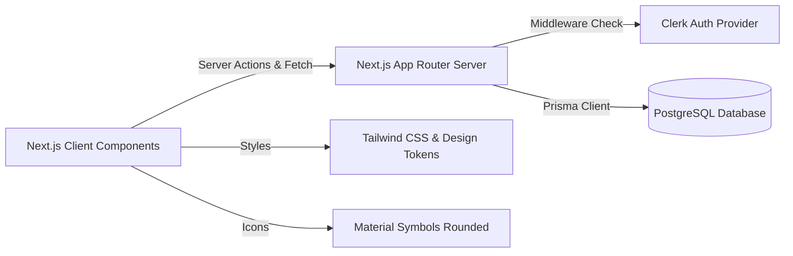
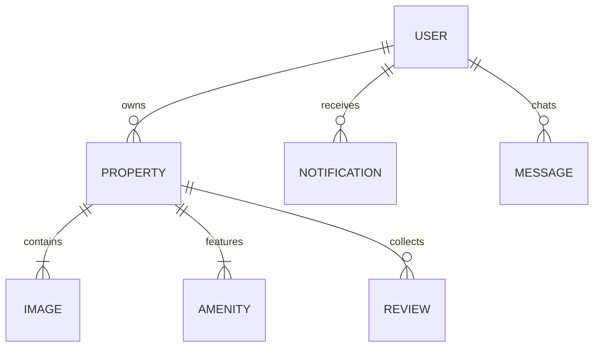

# Technical Requirements Document (TRD) — Ghar Foundation

This document defines the system architecture, database schema, security practices, and API contracts for the **Ghar Foundation** portal.

---

## 1. System Architecture



The application is built using a modern **Next.js 15 (App Router)** setup:
- **Client Tier**: Highly responsive React 19 client components optimized with Framer Motion animations.
- **Server Tier**: Next.js Server Actions for secure mutation operations (posting properties, reporting abuse, favoriting) and API routes for query-heavy search features.
- **Data Tier**: PostgreSQL database managed via Prisma ORM for type-safe queries.
- **Auth Provider**: Clerk handles user identity management, multi-tenant logins, and session lifecycle hooks.

---

## 2. Database Schema (Prisma ORM)

Below is the entity-relationship definition matching the Prisma structure:



### Prisma Models

```prisma
datasource db {
  provider = "postgresql"
  url      = env("DATABASE_URL")
}

generator client {
  provider = "prisma-client-js"
}

enum Role {
  GUEST
  RENTER
  OWNER
  BROKER
  ADMIN
}

enum FurnishedStatus {
  UNFURNISHED
  SEMI_FURNISHED
  FULLY_FURNISHED
}

enum GenderPreference {
  ANY
  FAMILY
  BACHELOR
  GIRLS_ONLY
}

model User {
  id               String         @id @default(uuid())
  name             String
  email            String?        @unique
  phone            String?        @unique
  image            String?
  role             Role           @default(RENTER)
  onboardingOption String?        // "FIND_HOME", "LIST_PROPERTY", "BOTH"
  properties       Property[]
  notifications    Notification[]
  sentMessages     Message[]      @relation("SentMessages")
  receivedMessages Message[]      @relation("ReceivedMessages")
  createdAt        DateTime       @default(now())
  updatedAt        DateTime       @updatedAt
}

model Property {
  id               String           @id @default(uuid())
  title            String
  description      String
  rent             Float
  deposit          Float
  maintenance      Float            @default(0)
  bedrooms         Int
  bathrooms        Int
  kitchen          Int              @default(1)
  balcony          Int              @default(0)
  parking          Boolean          @default(false)
  floor            Int              @default(0)
  area             Float            // Square feet
  availableFrom    DateTime         @default(now())
  propertyType     String           // "FLAT", "VILLA", "PG", "SHOP", "OFFICE"
  genderPreference GenderPreference @default(ANY)
  waterSupply      String
  electricity      String
  internet         Boolean          @default(false)
  isFurnished      FurnishedStatus  @default(UNFURNISHED)
  district         String
  city             String
  areaName         String
  address          String
  landmark         String?
  pincode          String
  latitude         Float
  longitude        Float
  ownerId          String
  owner            User             @relation(fields: [ownerId], references: [id], onDelete: Cascade)
  images           Image[]
  amenities        Amenity[]
  reviews          Review[]
  isVerified       Boolean          @default(false)
  isFeatured       Boolean          @default(false)
  viewsCount       Int              @default(0)
  createdAt        DateTime         @default(now())
  updatedAt        DateTime         @updatedAt
}

model Image {
  id         String   @id @default(uuid())
  url        String
  propertyId String
  property   Property @relation(fields: [propertyId], references: [id], onDelete: Cascade)
}

model Amenity {
  id         String   @id @default(uuid())
  name       String
  propertyId String
  property   Property @relation(fields: [propertyId], references: [id], onDelete: Cascade)
}

model Review {
  id         String   @id @default(uuid())
  rating     Int      @default(5)
  comment    String
  propertyId String
  property   Property @relation(fields: [propertyId], references: [id], onDelete: Cascade)
  userId     String
  createdAt  DateTime @default(now())
}

model Notification {
  id        String   @id @default(uuid())
  userId    String
  user      User     @relation(fields: [userId], references: [id], onDelete: Cascade)
  title     String
  message   String
  type      String   // "APPROVAL", "FAVORITE_UPDATE", "MESSAGE"
  isRead    Boolean  @default(false)
  createdAt DateTime @default(now())
}

model Message {
  id         String    @id @default(uuid())
  senderId   String
  sender     User      @relation("SentMessages", fields: [senderId], references: [id], onDelete: Cascade)
  receiverId String
  receiver   User      @relation("ReceivedMessages", fields: [receiverId], references: [id], onDelete: Cascade)
  propertyId String?
  content    String
  createdAt  DateTime  @default(now())
}
```

---

## 3. Clerk SSO Authentication Setup

Clerk is configured using environmental parameters linked to the Clerk Dashboard APIs:
- `NEXT_PUBLIC_CLERK_PUBLISHABLE_KEY`: API public key.
- `CLERK_SECRET_KEY`: Backend secret key.
- `NEXT_PUBLIC_CLERK_SIGN_IN_URL`: `/login` redirection.

### Redirection & Open Redirect Security
To prevent open-redirect vulnerabilities, all redirects targeting custom landing queries must be scrubbed:
```typescript
const params = new URLSearchParams(window.location.search);
let url = params.get("redirect_url") || "/dashboard";
try {
  const parsed = new URL(url);
  if (parsed.origin === window.location.origin) {
    url = parsed.pathname + parsed.search + parsed.hash;
  } else {
    url = "/dashboard"; // Fallback to safe zone
  }
} catch (e) {
  // Relative URLs will throw an error, which is safe to keep directly
}
```

---

## 4. Key Server Actions & API Contracts

### 4.1 `createProperty(data: PropertyInput)`
*   **Description**: Creates a new rental property.
*   **Access Control**: User session role must be `OWNER`, `BROKER`, or `ADMIN`.
*   **Validation**: Zod schema check (Title length > 10, positive rent, valid coordinates).

### 4.2 `toggleFavorite(propertyId: string)`
*   **Description**: Saves or removes a property from the user's favorites array.
*   **Access Control**: Logged-in credentials required.

### 4.3 `reportAbuse(propertyId: string, details: string)`
*   **Description**: Flags a suspicious listing. Creates an abuse report in database and increments public warnings.
*   **Access Control**: Any authenticated user or guest.

### 4.4 `verifyListing(propertyId: string, status: boolean)`
*   **Description**: Approves or denies a rental listing.
*   **Access Control**: User session role must be `ADMIN`.

---

> [!WARNING]
> Environment changes to Prisma schemas require executing `npx prisma migrate dev` before pushing to development branches to prevent table drift.
