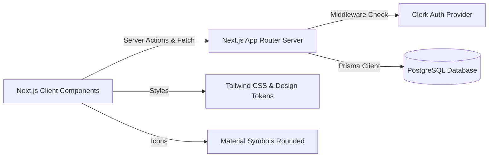
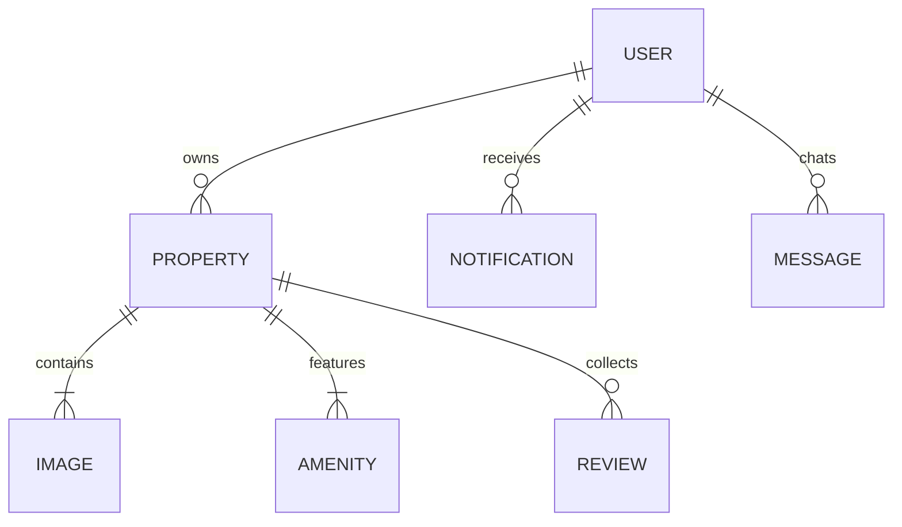

# Technical Requirements Document (TRD) — Ghar Foundation

This document defines the system architecture, database schema, security practices, and API contracts for the **Ghar Foundation** portal.

---

## 1. System Architecture



The application is built using a modern **Next.js 15 (App Router)** setup:
- **Client Tier**: Highly responsive React 19 client components optimized with Framer Motion animations.
- **Server Tier**: Next.js Server Actions for secure mutation operations (posting properties, reporting abuse, favoriting) and API routes for query-heavy search features.
- **Data Tier**: PostgreSQL database managed via Prisma ORM for type-safe queries.
- **Auth Provider**: Clerk handles user identity management, multi-tenant logins, and session lifecycle hooks.

---

## 2. Database Schema (Prisma ORM)

Below is the entity-relationship definition matching the Prisma structure:



### Prisma Models

```prisma
datasource db {
  provider = "postgresql"
  url      = env("DATABASE_URL")
}

generator client {
  provider = "prisma-client-js"
}

enum Role {
  GUEST
  RENTER
  OWNER
  BROKER
  ADMIN
}

enum FurnishedStatus {
  UNFURNISHED
  SEMI_FURNISHED
  FULLY_FURNISHED
}

enum GenderPreference {
  ANY
  FAMILY
  BACHELOR
  GIRLS_ONLY
}

model User {
  id               String         @id @default(uuid())
  name             String
  email            String?        @unique
  phone            String?        @unique
  image            String?
  role             Role           @default(RENTER)
  onboardingOption String?        // "FIND_HOME", "LIST_PROPERTY", "BOTH"
  properties       Property[]
  notifications    Notification[]
  sentMessages     Message[]      @relation("SentMessages")
  receivedMessages Message[]      @relation("ReceivedMessages")
  createdAt        DateTime       @default(now())
  updatedAt        DateTime       @updatedAt
}

model Property {
  id               String           @id @default(uuid())
  title            String
  description      String
  rent             Float
  deposit          Float
  maintenance      Float            @default(0)
  bedrooms         Int
  bathrooms        Int
  kitchen          Int              @default(1)
  balcony          Int              @default(0)
  parking          Boolean          @default(false)
  floor            Int              @default(0)
  area             Float            // Square feet
  availableFrom    DateTime         @default(now())
  propertyType     String           // "FLAT", "VILLA", "PG", "SHOP", "OFFICE"
  genderPreference GenderPreference @default(ANY)
  waterSupply      String
  electricity      String
  internet         Boolean          @default(false)
  isFurnished      FurnishedStatus  @default(UNFURNISHED)
  district         String
  city             String
  areaName         String
  address          String
  landmark         String?
  pincode          String
  latitude         Float
  longitude        Float
  ownerId          String
  owner            User             @relation(fields: [ownerId], references: [id], onDelete: Cascade)
  images           Image[]
  amenities        Amenity[]
  reviews          Review[]
  isVerified       Boolean          @default(false)
  isFeatured       Boolean          @default(false)
  viewsCount       Int              @default(0)
  createdAt        DateTime         @default(now())
  updatedAt        DateTime         @updatedAt
}

model Image {
  id         String   @id @default(uuid())
  url        String
  propertyId String
  property   Property @relation(fields: [propertyId], references: [id], onDelete: Cascade)
}

model Amenity {
  id         String   @id @default(uuid())
  name       String
  propertyId String
  property   Property @relation(fields: [propertyId], references: [id], onDelete: Cascade)
}

model Review {
  id         String   @id @default(uuid())
  rating     Int      @default(5)
  comment    String
  propertyId String
  property   Property @relation(fields: [propertyId], references: [id], onDelete: Cascade)
  userId     String
  createdAt  DateTime @default(now())
}

model Notification {
  id        String   @id @default(uuid())
  userId    String
  user      User     @relation(fields: [userId], references: [id], onDelete: Cascade)
  title     String
  message   String
  type      String   // "APPROVAL", "FAVORITE_UPDATE", "MESSAGE"
  isRead    Boolean  @default(false)
  createdAt DateTime @default(now())
}

model Message {
  id         String    @id @default(uuid())
  senderId   String
  sender     User      @relation("SentMessages", fields: [senderId], references: [id], onDelete: Cascade)
  receiverId String
  receiver   User      @relation("ReceivedMessages", fields: [receiverId], references: [id], onDelete: Cascade)
  propertyId String?
  content    String
  createdAt  DateTime  @default(now())
}
```

---

## 3. Clerk SSO Authentication Setup

Clerk is configured using environmental parameters linked to the Clerk Dashboard APIs:
- `NEXT_PUBLIC_CLERK_PUBLISHABLE_KEY`: API public key.
- `CLERK_SECRET_KEY`: Backend secret key.
- `NEXT_PUBLIC_CLERK_SIGN_IN_URL`: `/login` redirection.

### Redirection & Open Redirect Security
To prevent open-redirect vulnerabilities, all redirects targeting custom landing queries must be scrubbed:
```typescript
const params = new URLSearchParams(window.location.search);
let url = params.get("redirect_url") || "/dashboard";
try {
  const parsed = new URL(url);
  if (parsed.origin === window.location.origin) {
    url = parsed.pathname + parsed.search + parsed.hash;
  } else {
    url = "/dashboard"; // Fallback to safe zone
  }
} catch (e) {
  // Relative URLs will throw an error, which is safe to keep directly
}
```

---

## 4. Key Server Actions & API Contracts

### 4.1 `createProperty(data: PropertyInput)`
*   **Description**: Creates a new rental property.
*   **Access Control**: User session role must be `OWNER`, `BROKER`, or `ADMIN`.
*   **Validation**: Zod schema check (Title length > 10, positive rent, valid coordinates).

### 4.2 `toggleFavorite(propertyId: string)`
*   **Description**: Saves or removes a property from the user's favorites array.
*   **Access Control**: Logged-in credentials required.

### 4.3 `reportAbuse(propertyId: string, details: string)`
*   **Description**: Flags a suspicious listing. Creates an abuse report in database and increments public warnings.
*   **Access Control**: Any authenticated user or guest.

### 4.4 `verifyListing(propertyId: string, status: boolean)`
*   **Description**: Approves or denies a rental listing.
*   **Access Control**: User session role must be `ADMIN`.

---

## 5. Identity Verification & SMS Infrastructure Architecture

### 5.1 SMS OTP Service (`src/lib/services/sms.ts`)
The platform supports multi-provider failover for phone authentication and OTP delivery:
*   **Provider 1: Fast2SMS (Production India Route)**
    *   Endpoint: `https://www.fast2sms.com/dev/bulkV2`
    *   Payload: `{ route: "otp", variables_values: code, numbers: indian10Digit }`
    *   Latency: < 2.5 seconds on Indian mobile carriers.
    *   Cost Efficiency: ~₹0.20 / SMS without upfront DLT template lock-in during MVP stage.
*   **Provider 2: Twilio (Global Fallback)**: Used for international numbers (+1, +44, etc.).
*   **Provider 3: Console Mock (Local Dev)**: Outputs 6-digit OTP code directly to server logs when `FAST2SMS_API_KEY` is unset.

### 5.2 Aadhaar Verification Architecture & Compliance
To comply with the **Aadhaar Act 2016 (Section 29)** and **DPDP Act 2023**:
*   **Raw 12-digit Aadhaar numbers are NEVER stored** in the database.
*   Only **masked Aadhaar strings** (`XXXX XXXX 1234`) are persisted in `User.aadhaarMasked`.
*   Uploaded identity document photos are stored in private S3/Cloudinary buckets with signed time-limited access URLs.

#### Flow & Validation Engine:
1.  **Mathematical Verhoeff Check (`src/lib/validations/id-verification.ts`)**:
    *   Validates the dihedral group $D_5$ checksum digit to reject synthetically generated fake 12-digit numbers before making any external API calls.
2.  **Phase 1 Manual Admin Verification**:
    *   Endpoint: `POST /api/verification/aadhaar`
    *   State transition: `kycStatus = "UNDER_REVIEW"` -> Admin checks front/back document -> `kycStatus = "VERIFIED"`.
3.  **Phase 2 Automated UIDAI OTP Pipeline (Sub-KUA)**:
    *   Integration candidate: Surepass / Cashfree Verification API.
    *   Contract:
        *   `POST /api/verification/aadhaar-otp/generate`: Dispatches UIDAI OTP to user's Aadhaar-linked mobile number.
        *   `POST /api/verification/aadhaar-otp/verify`: Submits OTP to UIDAI; receives signed e-KYC response (Full Name, Gender, DOB, Care of, Full Address, and Profile Photo).

---

## 6. Programmatic SEO Engine & Schema Architecture

### 6.1 Server-Side Rendering (SSR) & Dynamic Metadata
To guarantee search engine crawlability without relying on client-side JavaScript execution:
*   **Property Detail Pages (`src/app/property/[id]/page.tsx`)**:
    *   Utilizes `generateMetadata({ params })` to generate page-specific `<title>`, `<meta name="description">`, `canonical`, and OpenGraph/Twitter social cards directly on the server.
    *   Passes `initialProperty` directly to client components to eliminate flash of "Property Not Found" states.
*   **Dynamic Sitemap Generator (`src/app/sitemap.ts`)**:
    *   Automatically generates XML sitemaps for:
        1. Core static routes (`/`, `/search`, `/police-verification`, `/agreements`, `/refund-policy`).
        2. Programmatic Uttarakhand locality queries (`/search?city=Dehradun&q=Bidholi`, etc.).
        3. All verified property pages (`/property/[id]`) dynamically queried from PostgreSQL.

### 6.2 Structured Data (JSON-LD)
Injected in `src/app/layout.tsx` and property detail components to secure rich Google SERP results:
```json
{
  "@context": "https://schema.org",
  "@graph": [
    {
      "@type": ["Organization", "RealEstateListingService"],
      "name": "Ghar Foundation",
      "url": "https://gharfoundation.vercel.app",
      "address": {
        "@type": "PostalAddress",
        "streetAddress": "IT Park, Sahastradhara Road",
        "addressLocality": "Dehradun",
        "addressRegion": "Uttarakhand",
        "postalCode": "248013",
        "addressCountry": "IN"
      }
    }
  ]
}
```

---

> [!WARNING]
> Environment changes to Prisma schemas require executing `npx prisma db push` or `npx prisma migrate dev` before pushing to development branches to prevent table drift.
