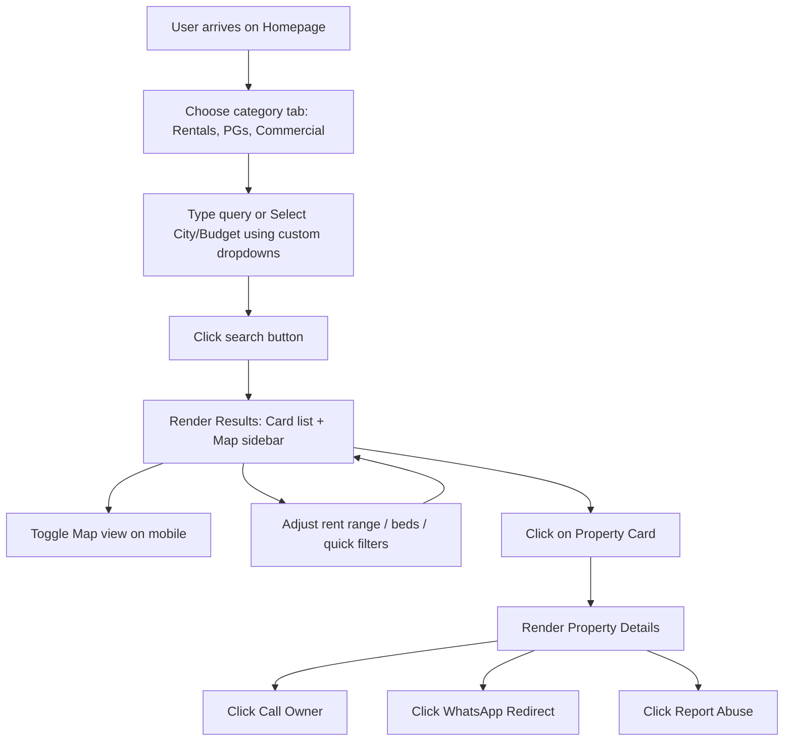
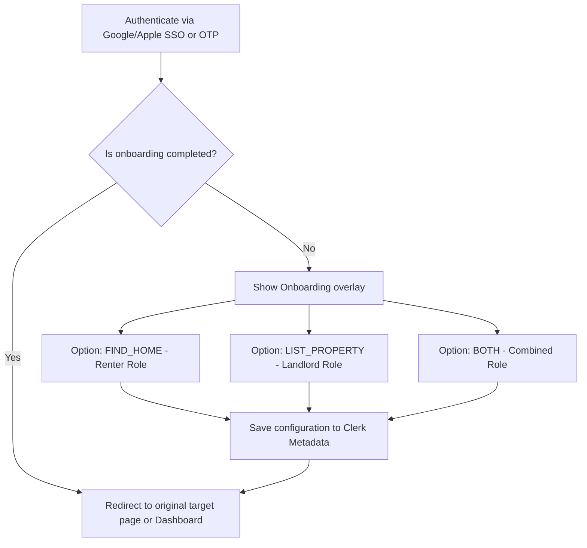
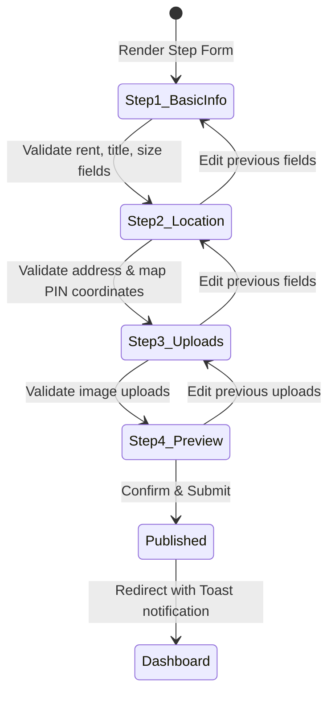

# User Flow & UI/UX Specification Document — Ghar Foundation

This document details the navigation flows, state transitions, onboarding states, design tokens, and micro-interactions of the **Ghar Foundation** platform.

---

## 1. Interaction & User Flow Diagrams

### 1.1 Discovery & Search Flow
This diagram maps a tenant's search pathway, showing interactive filters, map integrations, and connection checkpoints:



### 1.2 Onboarding & Role Selection Flow
This diagram details the onboarding sequence triggered immediately post-Clerk authentication:



### 1.3 Multi-Step Landlord Wizard Flow
Landlords and brokers post properties via a linear multi-step wizard to prevent cognitive overload:



---

## 2. Design System Tokens & Specs

### 2.1 Color Palette

| Name | Light Mode Value | Dark Mode Value | Usage |
| :--- | :--- | :--- | :--- |
| **Primary** | `#2E7D32` (Forest Green) | `#4CAF50` (Emerald Green) | Branding elements, primary buttons, highlights |
| **Secondary**| `#15803d` (Green 700) | `#22c55e` (Green 500) | Verification tags, badges |
| **Background**| `#ffffff` | `#0b0f19` (Dark Navy Blue) | Primary layout wrappers, body backdrops |
| **Surface** | `#f8fafc` | `#111827` (Gray 900) | Card grids, forms, dialog overlays |
| **Text Main** | `#0f172a` (Slate 900) | `#f8fafc` | Headers, titles, body content |
| **Text Secondary**| `#64748b` (Slate 500) | `#94a3b8` | Subtitles, helper text |

### 2.2 Typography Hierarchy
- **Font Families**:
  - Headings: `Inter`, sans-serif (Font-weight: 700/800/900)
  - Body: `Outfit`, sans-serif (Font-weight: 400/500/600)
- **Scale**:
  - Page Hero Header: `font-black text-4xl sm:text-5xl md:text-6xl leading-[1.1]`
  - Section Heading: `font-bold text-2xl text-textPrimary`
  - Subheadings: `font-bold text-sm text-textSecondary`
  - Body Copy: `text-xs text-textSecondary leading-relaxed`

### 2.3 Component Dimension Parameters
- **Border Radii**:
  - Layout Cards: `rounded-2xl` (`16px`)
  - Form Fields & Inputs: `rounded-btn` (`12px`)
  - Verification & Promo Tags: `rounded-full` (`999px`)
- **Spacing Grid**:
  - Horizontal Margins: `px-4 sm:px-6 lg:px-8` (Max width restricted to `max-w-7xl`)
  - Section Spacing: `space-y-16`

---

## 3. Premium Micro-Interactions

1.  **3D Floating Cards**:
    Floating hero visual cards use Framer Motion loop sequences:
    ```typescript
    animate={{ y: [0, -12, 0] }}
    transition={{ duration: 6, repeat: Infinity, ease: "easeInOut" }}
    ```
2.  **Smooth Interactive Hover**:
    Property cards lift upwards (`translate-y-[-6px]`) and activate border highlights (`transition-all duration-300`) to increase clickable cues.
3.  **Dropdown Transitions**:
    Custom City and Budget selectors fade in and slide down concurrently using Framer Motion `<AnimatePresence>`:
    ```typescript
    initial={{ opacity: 0, y: 10 }}
    animate={{ opacity: 1, y: 0 }}
    exit={{ opacity: 0, y: 10 }}
    ```
4.  **Role Swapping transitions**:
    Admin/Owner/Renter dashboards use CSS layout shifts to transition list cards without jumping page sizes.

---

> [!TIP]
> Ensure all interactive buttons on screens have unique descriptive testing attributes (`id`) to allow browser automation agents to audit workflows seamlessly.
